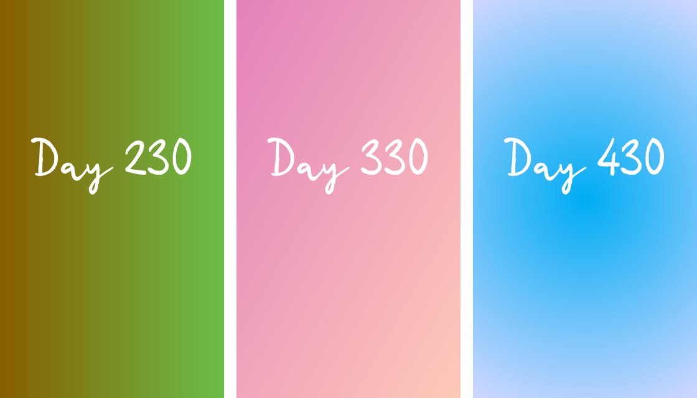

# instacover

A cover for every day's Instagram story: a full-screen gradient with "Day N" written across it, in
colours that never repeat. A Python script draws a whole run of covers ahead of time, and a small
Telegram bot sends the right one each morning.



## How the colours work

Each week gets its own pair of colours, chosen in OKLCH so they look equally bright, with hues
spread around the wheel by the golden ratio so no two weeks come close. Within a week the colours
drift a little each day. Every 84 days, about three months, the fade changes shape: horizontal,
diagonal, radial from the centre, radial from a corner, then vertical.

## Draw the covers

Python 3 with Pillow and NumPy.

```sh
mkdir -p output_stories
python3 allday.py           # Day_215.png to Day_600.png, 1080 x 1920, in output_stories/
python3 preview_colors.py   # color_preview.png: one swatch per week, to check the run at a glance
python3 testday.py          # one cover, to try out text position, size and colours
```

The first and last day and the text's place and size are at the top of `allday.py`.

The lettering is Pabasing by wepfont, free for personal use. Its licence doesn't allow sharing the
file, so it isn't in this repo: download it from its author and put `Pabasing.otf` next to the
scripts. Without it they fall back to Pillow's built-in font.

## The bot

`code.gs` is a Google Apps Script web app. Each day it works out the day number, finds that day's
`Day_N.png` in a Google Drive folder, sends it to one Telegram chat with the caption "Day N's
cover", and moves the five days before it to the bin. In that chat, `/sendnow` sends today's cover
straight away. Messages from any other chat are ignored.

To set it up:

1. Upload the covers to a Drive folder.
2. Paste `code.gs` into a new Apps Script project and set `START_DATE_STRING` and
   `START_DAY_NUMBER` at the top: the date that was Day `START_DAY_NUMBER`.
3. In Project Settings, add these Script Properties:
   - `BOT_TOKEN`: from BotFather.
   - `ALLOWED_CHAT_ID`: the only chat it answers and sends to.
   - `FOLDER_ID`: the Drive folder.
   - `WEBHOOK_URL`: the web app's address, ending in `/exec`.
   - `WEBHOOK_KEY`: a long random string.
4. Deploy it as a web app, run `forceSetWebhook` once, then add a daily time-driven trigger for
   `sendDailyStory`.

Apps Script can't read Telegram's secret-token header, so the key travels in the webhook's address.
Without the right key, a post to the script is ignored. Tokens and IDs live only in Script
Properties, never in the code.
